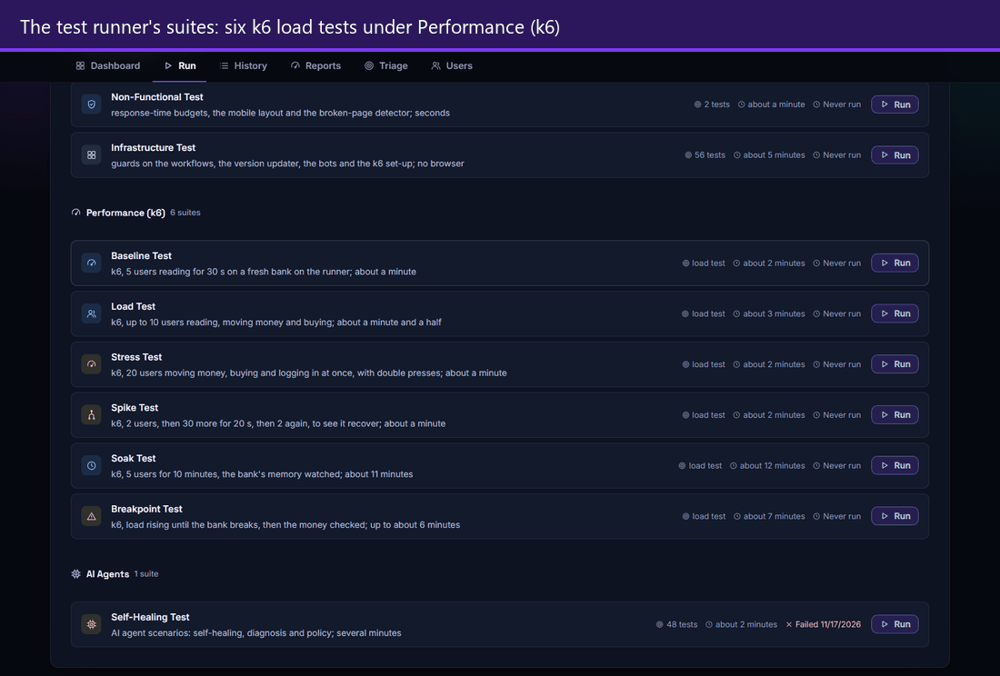
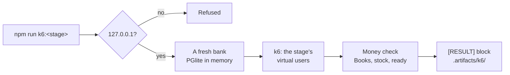
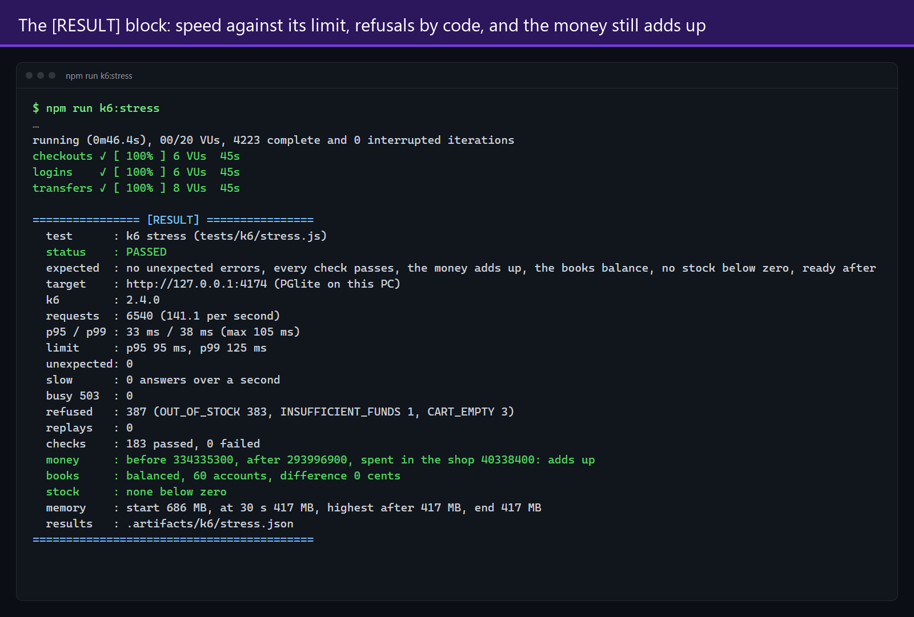

# Load tests with k6

[← Back to the README](../../README.md)

How fast Playground Bank stays when many people use it at once, and whether
its money still adds up afterwards. [k6](https://k6.io) (Grafana's free load
tester, version 2.4.0) plays the people; a small Node script starts a fresh
bank, runs one stage, and checks the money when it ends. Run it on your PC,
or from the test runner, where each stage is a suite under **Performance
(k6)**.

  

  The runner screens are the real ones (nothing was started there); the terminal is a real <code>npm run k6:stress</code>, cut but not edited.

## The stages

The usual six kinds of load test, each named the way a QA team names them:

- **baseline** (`npm run k6:baseline`, 30 s): 5 people reading what most
  visits read: the bank's state, the market, the shop, their own page and
  accounts. The numbers every other stage is compared with.
- **load** (`npm run k6:load`, under a minute): up to 10 people using the
  bank the usual way: mostly reading, some moving money, a few buying in the
  shop.
- **stress** (`npm run k6:stress`, 45 s): 20 people at once, moving money,
  buying and logging in, with short pauses, plus double presses: one transfer
  sent twice at the same instant with one key.
- **spike** (`npm run k6:spike`, 45 s): a quiet bank, 30 more people for 20
  seconds, then quiet again, to see it recover. The run reports each phase's
  timings apart.
- **soak** (`npm run k6:soak`, 10 minutes): the usual mix for ten minutes,
  to watch the bank's memory and whether it slows down over time.
- **breakpoint** (`npm run k6:breakpoint`, up to about 6 minutes): new visits
  start at a rate that rises from 10 a second towards 1000 over five minutes,
  whatever the bank's speed, and k6 stops the test itself the moment the bank
  breaks: any unexpected answer, 50 answers slower than a second, or a p95
  over 500 ms. The run reports the rate it reached. Breaking is this stage's
  result, so it passes on the money: after breaking, the money still adds
  up, the books balance, and the bank answers ready again. On this PC it
  broke at about 420 visits a second, with the money intact.

## From the test runner

The [test runner](test-runner.md) lists the six stages as suites under
**Performance (k6)**. A run there installs the pinned k6 on a GitHub machine,
checked against its published SHA256, starts a fresh bank on that machine,
and runs the stage with the same script. Its `[RESULT]` block is in the run's
summary. A target address is refused before anything starts: a load test
never goes to a deployed site.

## What each run reports

One `[RESULT]` block, like the tests', with:

- **requests** and requests per second;
- **p95 / p99**: 95 or 99 requests in 100 were at least this fast, against
  the stage's limit;
- **unexpected**: answers the bank should never give (a 500, a refused
  transfer that was valid). Must be 0;
- **slow**: answers that took over a second;
- **busy 503** and **refused**: the bank's own answers, counted apart because
  they are its design: "busy, try again" when too many passwords are checked
  at once, and clear refusals like `OUT_OF_STOCK` or `INSUFFICIENT_FUNDS`,
  each by its code;
- **replays**: transfers the bank answered from an earlier press with the
  same key, instead of moving the money again;
- **broke at** and **k6 behind** (breakpoint only): the rate the bank broke
  at and what broke it, and the visits k6 itself couldn't start on time;
- **checks**: the stage's own checks, such as "a double press never moves the
  money twice";
- **money**: the customers' money before and after, and what they spent in
  the shop. Transfers only move money between the run's own customers, so
  after must equal before minus the shop;
- **books**: the bank's own Books check after the run: every account's
  history adds up to its balance;
- **stock**: no product below zero;
- **memory**: the bank's memory at the start, 30 seconds in, its highest
  after that, and at the end.

The numbers are also written to `.artifacts/k6/<stage>.json`, each run
replacing the last. In a terminal, k6 shows a progress bar while it runs.

  

## The limits

A stage fails on any unexpected answer, a failed check, money that doesn't
add up, books out of balance, stock below zero, or a p95 or p99 over its
limit. The limits were set from three runs of each stage on this PC
(2026-11-19), never guessed: the worst of the three, doubled, rounded up to 5
ms. They are PGlite's numbers: PGlite runs one transaction at a time, so a
Postgres bank would show different ones.

| Stage      | Worst measured p95 / p99 | Limit p95 / p99          |
| ---------- | ------------------------ | ------------------------ |
| baseline   | 4.6 / 26.8 ms            | 10 / 55 ms               |
| load       | 13.6 / 36.8 ms           | 30 / 75 ms               |
| stress     | 46.7 / 61.1 ms           | 95 / 125 ms              |
| spike      | 12.7 / 31.2 ms           | 30 / 65 ms               |
| soak       | watched, not limited     | none                     |
| breakpoint | it is meant to break     | none: it stops by itself |

On GitHub the machine is slower and shared, so this PC's limits would fail
there for no reason. GitHub has its own, set the same way from three runs of
each stage on GitHub (2026-11-21):

| Stage    | Worst measured on GitHub p95 / p99 | GitHub limit p95 / p99 |
| -------- | ---------------------------------- | ---------------------- |
| baseline | 5.89 / 35.15 ms                    | 15 / 75 ms             |
| load     | 7.64 / 48.65 ms                    | 20 / 100 ms            |
| stress   | 74.58 / 92.47 ms                   | 150 / 185 ms           |
| spike    | 6.51 / 10.18 ms                    | 15 / 25 ms             |

Stress varies most there: its p95 went from 39 to 75 ms across the three
runs. Every other check counts on GitHub exactly as on the PC.

## What it never does

- **It never goes to a deployed site.** The run script refuses any address
  but `http://127.0.0.1:<port>` before it starts anything, and the k6 helpers
  refuse again before a single request, so it only ever loads the bank it
  started on the same machine. Render, Neon and every other site are out of
  reach; `tests/e2e/infra/k6-run.spec.ts` checks the refusals on every pull
  request.
- **It never runs by itself.** On your PC you start it; on GitHub, only a
  person pressing Run in the test runner does. No pull request, push or
  schedule starts one.
- **It never touches Neon.** The bank it starts has `DATABASE_URL` removed,
  so it runs on PGlite in memory, fresh for each run.
- **It never uses port 4173.** It uses 4174: a Playwright run frees 4173 by
  itself and would stop the load test's bank halfway.

## Keeping k6 current

The repo pins k6 in two places that move together: `scripts/k6/run.js`
(`K6_VERSION`) and the test runner's workflow,
`.github/workflows/remote-test-runner.yml` (`K6_VERSION` and its
`K6_SHA256`). `npm run infra:report` checks the pin against grafana/k6's own
releases with the usual 7-day wait, and an update changes all three, the
SHA256 taken from k6's published checksums. `/recall`'s sync says when the
PC's k6 differs. Update the PC with
`winget upgrade --id GrafanaLabs.k6 --exact`.
