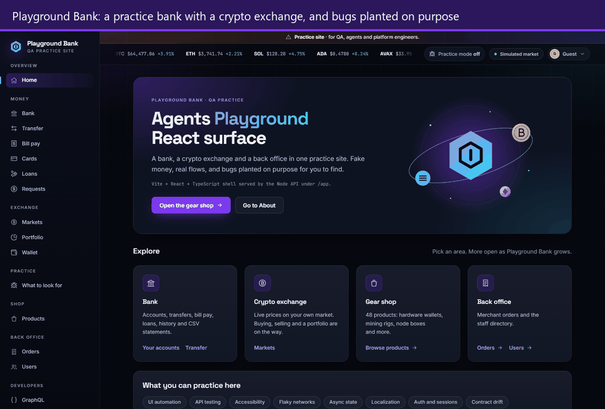
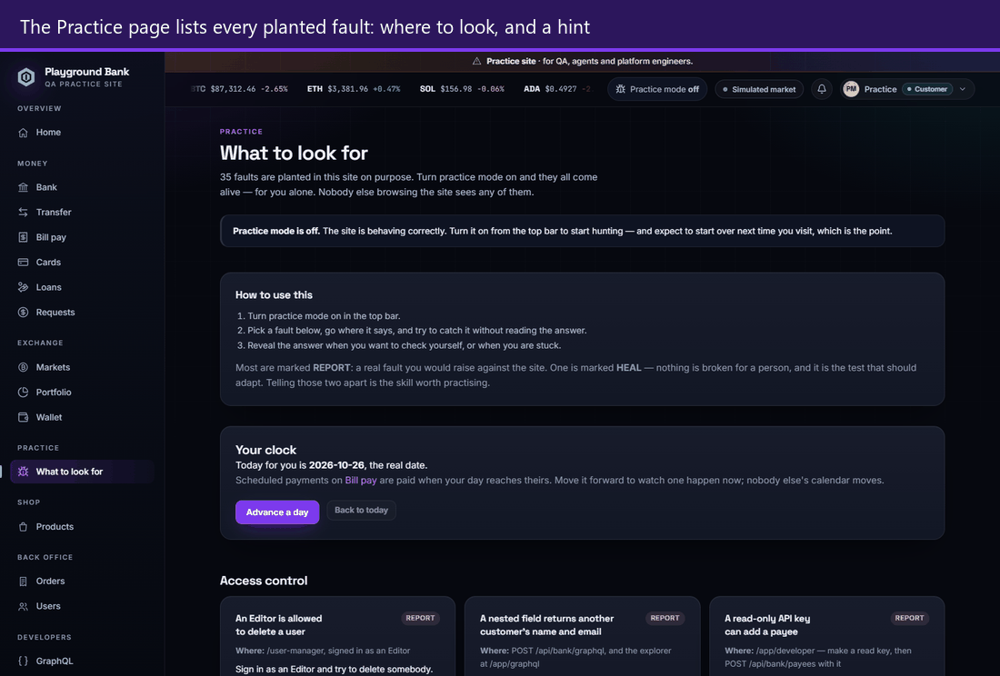
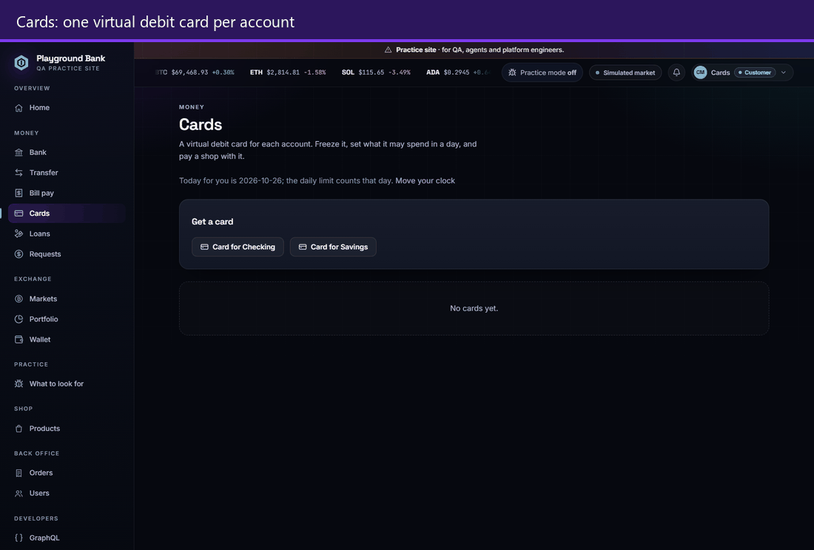
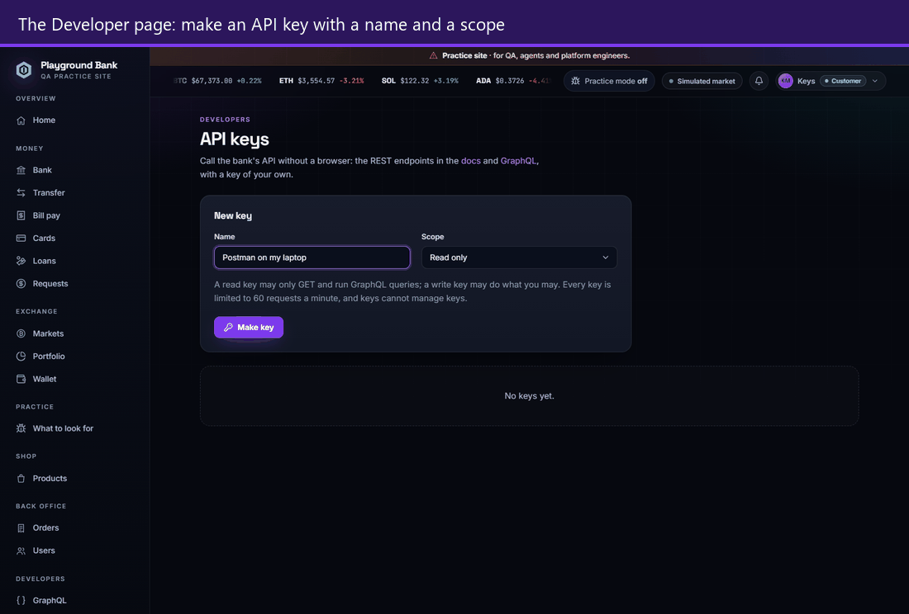

# Playground Bank

[← Back to the README](../../README.md)

<p align="center">
  
</p>

A practice site for testers, like ParaBank with a crypto exchange's look: fake
money, real accounts, and bugs planted on purpose. Open `/app` after
`npm start`, or try it [live](https://agents-playground-app.onrender.com/app).

```
Browser ──▶ /app (React) ──▶ /api/bank ──▶ Postgres
                                           Neon live, PGlite locally and in CI,
                                           a throwaway Neon branch per pull request
```

Every table it keeps, drawn from the migrations: **[docs/database.md](../database.md)**.

- **Real accounts.** Sign up, log in, edit your profile, and pick a currency and
  number format in settings. The Devices page lists every browser signed in to
  your account, with an End button per device and "log out everywhere else".
  Five wrong passwords put a hold on that email from that client — a 429 with
  a `Retry-After` — and the hold lifts by itself; the pair is what is held, so
  one visitor's mistakes never lock a demo account for everybody.
- **Money.** Every customer opens funded, with their own amounts: the balances
  are drawn from your own account, so no two people start the same. Add
  funds (up to $1,000,000 at a time), open more accounts, send money to your own
  accounts or another customer's, filter the history, and download a CSV
  statement.
- **Bill pay and loans.** Save payees and pay bills, now or on a date: once,
  every week or every month, with a payment due on a weekend paid on the Monday
  after and a monthly one set for the 31st landing on the last day of a shorter
  month. Payments run on your own clock: the Practice page has a card that
  moves your calendar forward a day at a time, so a bill due tomorrow can be
  watched getting paid now, and nobody else's day moves. Ask for a loan of $1,000 to
  $1,000,000 with a live quote and the full schedule; an Admin approves or
  rejects it, and an approved loan is paid straight into the account. **There
  is no rate card.** Your rate is worked out from what the bank can see of you
  -- what you hold, how long you have banked here, how your earlier loans went,
  and how big the ask is next to your own money -- and the quote tells you
  which of those moved it. Spend money and your next offer gets dearer.
- **Cards.** A virtual debit card for each account, with a daily limit that
  starts as a share of the account's balance and is yours to change. Pay a shop
  with it and the purchase lands in the same history as everything else; a
  frozen card, a limit reached for the day, or an empty account declines it and
  the bell tells you why. The limit counts your own day, so it resets when your
  clock does. Freeze and unfreeze your own card; an Admin can freeze any card
  from a customer's profile, and only the bank can undo a bank freeze. The full
  number and CVV show only on request.
- **Connected screens.** What one person does shows up for another: a bell with
  notifications (money received, a loan decided, a request answered, a reply
  from support), money requests the other customer pays or declines, and
  support tickets, raised from any transaction, that staff answer from an inbox.
- **Three roles.** A Customer sees their own money, Support sees every user's
  profile and accounts and answers support tickets, and an Admin can also change
  roles, lock accounts and decide loans (never their own).
  The server checks the role on every request, not just the page.
- **Demo accounts**, password `demo1234`: `maya@` (Customer), `sam@` (Support),
  `alex@` (Admin) and `lee@` (locked), all `@playgroundbank.test`. They are
  read-only; sign up to move money or edit.
- **API keys of your own.** Make a key on the Developer page with a name and
  a scope, read or read-and-write, and it is shown exactly once; after that
  the site knows only its first characters. Send it as a bearer token and the
  REST API and GraphQL answer as you, from Postman, curl or a test. A read key
  can look but not change, every key is limited per minute with the usual
  `X-RateLimit` headers and a 429 that says when to retry, keys cannot make
  keys, and revoking one shuts it off at once. Swagger knows the scheme, so
  "Authorize" works in the docs.
- **A GraphQL API** at `/api/bank/graphql`, over the same accounts, money and
  rules as REST: ask for exactly the fields you want, and read four screens'
  worth of data in one request. Cards, limit orders, price alerts and API keys
  go through it too, with the same rules as REST. Long lists come a page at a
  time with a cursor, so a payment that lands while you page never shifts the
  pages you have not read, and a cost limit refuses a query that is too wide
  the way the depth limit refuses one too deep. The schema is checked in as
  `bank/schema.graphql`. The explorer at `/app/graphql` has ready-made queries
  for all of it, runs them against your own session and browses the live
  schema with every field's description.
- **A database you can read.** Every table, column, constraint and index is in
  `bank/schema.sql`, and drawn in [`docs/database.md`](../database.md). Both
  are generated from the migrations and checked by the suite, so they cannot
  drift. `npm run db:audit` fills a throwaway copy with tens of thousands of
  rows and prints how the busiest queries run; it found three missing
  indexes, now added.
- **A market that is yours alone.** Eight coins with live practice prices that
  move while you watch. Your prices are not anybody else's: open the same coin
  on another machine and it sits on a different line, climbing while yours
  falls. Each coin has its own page with a chart over an hour, a day, a week or
  a month, and the strip across the top shows the same prices as the list.
- **A crypto look.** A dark exchange-style theme and a crypto gear shop where
  each of the 48 products has its own icon.

- **Buying and selling, with real bank money.** Ask for a price, and the bank
  holds it for fifteen seconds while you decide; confirm, and the money leaves
  your Checking account and the coin arrives. Selling pays straight back in.
  The fee is yours too: it starts at 0.30% and falls the more you trade.
- **A portfolio that moves.** What you hold, what it is worth on your own
  prices right now, what you paid, and whether you are up or down -- changing
  while the page is open. Every buy and sell lands in the same history as your
  transfers and bills, so there is one story, not two.

- **Orders and alerts.** Tell the exchange to buy at or below a price, or
  sell at or above one, and it fills when your own price gets there, through
  the same quote and fee as a trade by hand. Ask to be told once when a coin
  goes above or below a level, and the bell says so with the price it saw.
  Nothing watches a feed: orders and alerts are checked against your price
  whenever you are on the site, and a test can even ask for the check at a
  past instant. The first thing here that acts without a click.
- **A wallet with real addresses.** Every coin gets you an address like
  `pbx1btc7KZJ3E8B2RTDM`. Give one out and somebody can send you coin; send to
  one and the site checks it before anything moves, because the last three
  characters are a checksum. A network fee comes out in the coin itself.
- **Swapping.** Turn one coin straight into another at your own two prices,
  with the fee shown before you commit. No bank account involved.

- **Practice mode.** One switch in the top bar turns every planted fault in the
  site on at once — and only for you. Anyone else browsing at the same time
  still sees a site that behaves. Turn it off and everything is correct again;
  leave and come back and you start clean, the way a practice site should.
- **A page that tells you what to hunt for.** `/app/practice` lists all 35
  planted faults: where to go, what to try, and a reveal you open when you want
  to check yourself. Most are marked REPORT — a real fault you would raise. One
  is marked HEAL: nothing is broken for a person, and it is the test that should
  adapt. Telling those apart is the skill worth practising.

- **The headers a bank would send.** Every response carries a Content Security
  Policy — a fresh nonce per page view for the app, hashes for the classic
  pages' inline scripts — plus no framing, no MIME sniffing, a referrer
  policy, a permissions policy, the three cross-origin isolation headers, and
  HSTS behind https. One module, `security-headers.js`, serves them all. The
  OWASP ZAP baseline scan went from 2 Medium and 5 Low findings to none; what
  is left is informational, about caching and the fact that this is a
  single-page app. A browser walk through every page in the suite proves the
  policy refuses nothing the site needs.

<p align="center">
  
</p>
<p align="center">
  <sub>Practice mode: one switch arms every fault for you alone. Here a loan's schedule never pays it off.</sub>
</p>

<table>
  <tr>
    <td width="50%"></td>
    <td width="50%"></td>
  </tr>
  <tr>
    <td><sub>Cards: get one, pay a shop, watch the purchase land.</sub></td>
    <td><sub>API keys: made once, shown once, then only the first characters.</sub></td>
  </tr>
</table>

The pictures on this page are recorded by `npm run media:record`, so they can
be made again whenever the screens change.
