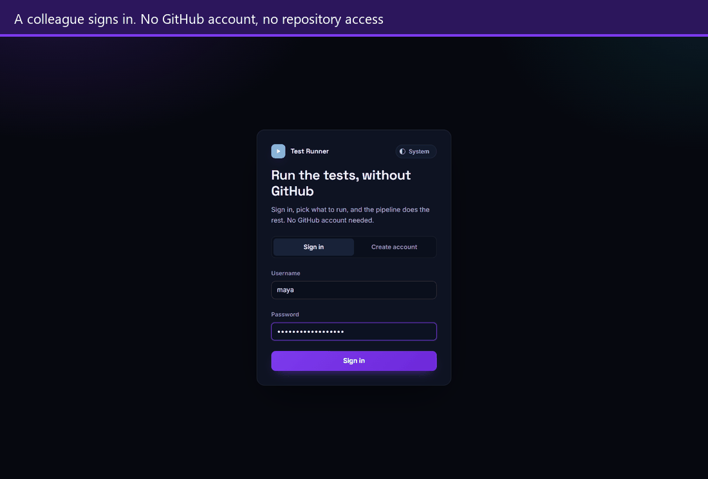
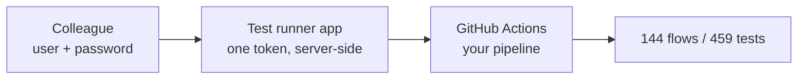
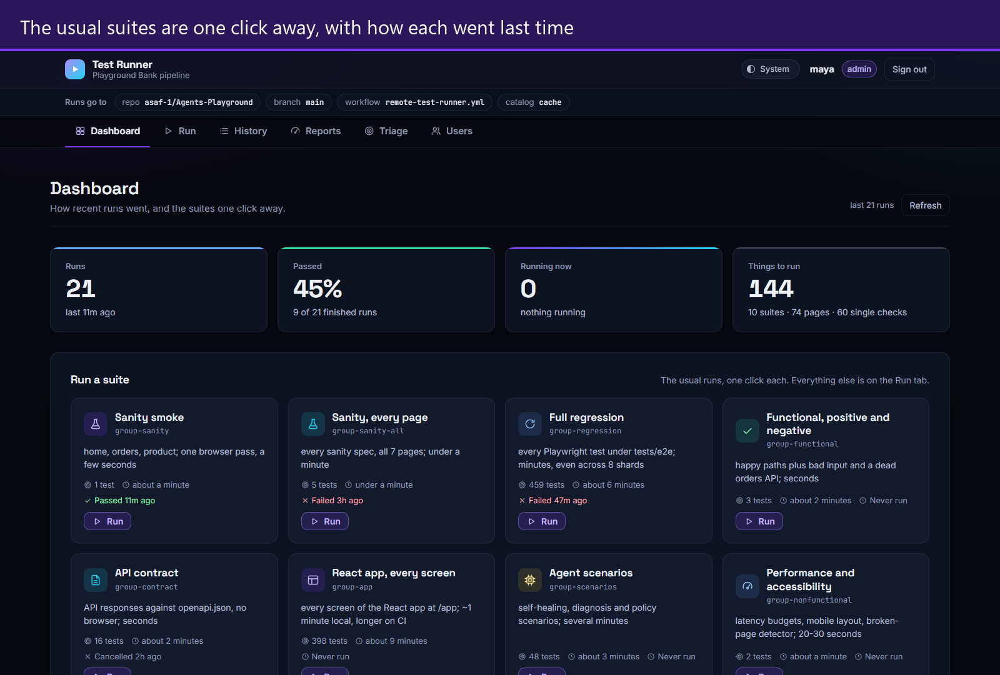
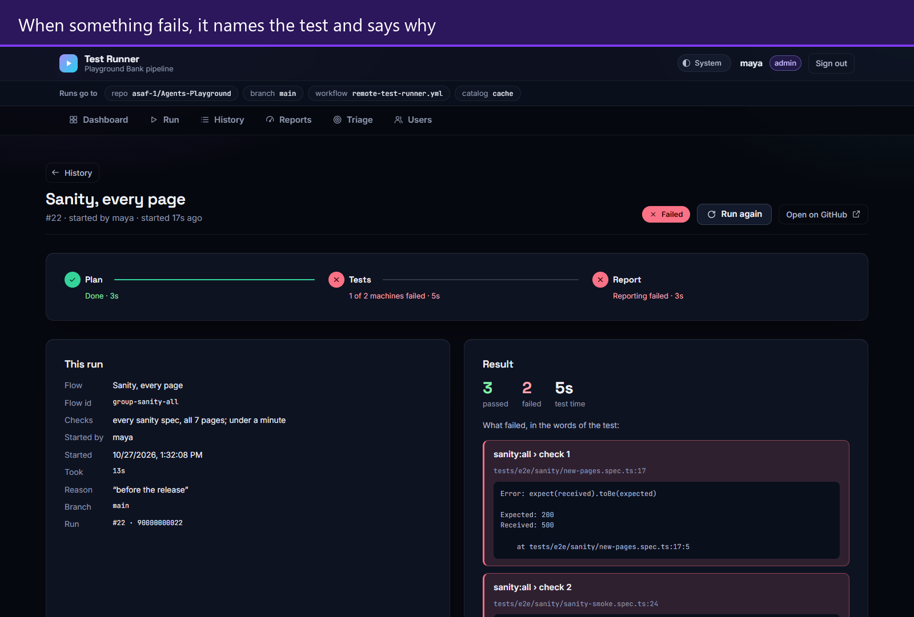
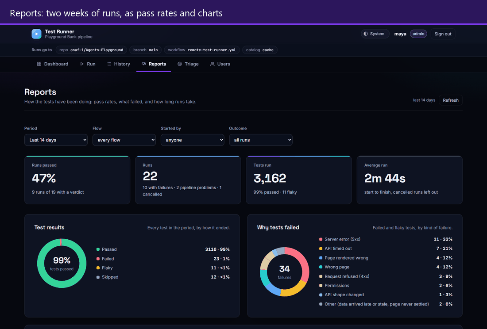
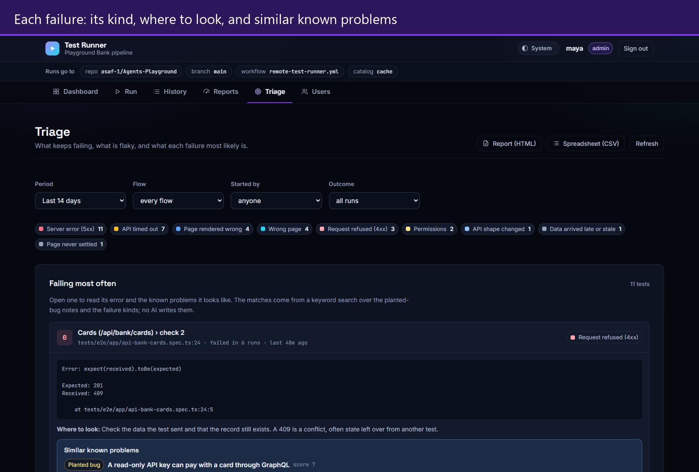

# The remote test runner

[← Back to the README](../../README.md)

<p align="center">
  
</p>
<p align="center">
  <sub>Recorded with the runner's stub mode, so these runs are pretend; the screens are the real ones.</sub>
</p>

The problem it solves: someone needs to run your test suite, and giving them
repository access is the wrong answer.

They get a username and a password on a separate web app. The app holds one
fine-grained GitHub token server-side and dispatches
`.github/workflows/remote-test-runner.yml` on their behalf. They never see the
repository, the pipeline, or the token — and it works with your machine switched
off.



<p align="center">
  
</p>

- **Pick what to run, in plain words.** Three levels: **suites** for the usual
  runs (Sanity smoke, Full regression, API contract…), **pages** for one screen
  or API area of the site, and **single checks** for one block of tests. Each
  has a sentence on what it checks — read from the comment at the top of its
  spec — how many tests it holds, about how long it takes, and how it went last
  time. Search narrows any level and says where else a word turns up.
- **One question before it starts.** What runs, where, in which browser, on how
  many machines, and about how long, with a box for why.
- **Watch it go.** The run's own page shows Plan, the tests and the report as
  they happen, then which tests failed and the assertion that failed them, the
  files the run left, and the console output one job at a time. Cancel it while
  it runs; run it again when it is done.
- **History you can search.** By flow or by person, filtered by outcome. A
  pipeline that broke before the tests ran is shown apart from a test failure.
- **Tested against a fake GitHub.** `TR_GITHUB_STUB=1` swaps GitHub for a stub
  inside the runner, so its own 53 tests (`npm run test:runner`) can
  press Run as often as they like without starting a single real pipeline. Off
  unless set, and the header says so when it is on.
- **Self-updating.** `flow-catalog.yml` regenerates the catalog on every push, so
  a new spec appears in the runner without anyone touching the runner.
- **Zero npm dependencies.** CommonJS and `node:` builtins only, no build step;
  it wears Playground Bank's own fonts and colours.

<p align="center">
  
</p>

## Reports and Triage

<p align="center">
  
</p>

Two tabs that read the last 1, 7 or 14 days of runs and need no database. The
run list and each run's results file are read on request, and a finished run's
results are cached. GitHub keeps a results file for 14 days, which is why 14 is
the longest period.

- **Reports.** Runs passed, tests run and average run time; a donut of how every
  test ended and one of why tests failed; the pass rate and the tests of each
  run; how long runs took; failures by flow. Filters for period, flow, person
  and outcome apply to every chart. The charts are SVG drawn by the page itself,
  with no chart library: the runner has no dependencies, and its CSP allows
  scripts from its own origin only.
- **Triage.** The tests that fail most, the flaky ones, and failures with the
  same error grouped into one line. Each failure gets a **kind**, named exactly
  as the framework's `FailureClassifier` names it (`api-server-error`,
  `ui-missing-locator`, `permissions-or-rbac`…), read from the error message by
  ordered rules, and a line on where to look.
- **Similar known problems (RAG, retrieval only).** For each failing test, the
  three notes most likely to explain it, chosen from the 35 planted bugs (built
  from `practice.js` by `npm run knowledge:build`) and the failure kinds. The
  ranking is BM25, the classic search-engine formula, in plain JavaScript: no
  embeddings, no model, and nothing leaves the server. An eval in the runner's
  tests searches with every planted-bug test title, minus the bug's name, and
  checks the right bug comes back: **25 of 25 first**.
- **Download.** An HTML report — a summary and donut, then one section per kind
  of failure with its tests, errors and similar known problems — that opens in
  any browser and prints to PDF. Or a CSV, one row per failed or flaky test,
  with cells guarded against spreadsheet formulas.

<p align="center">
  
</p>

```bash
npm run flows:list                        # every flow, with its id
npm run test:flow -- --flow group-sanity  # run one locally
npm run test:remote -- --flow group-sanity
npm run test:runner                       # the runner's own tests, stubbed
npm run knowledge:build                   # refresh the Triage notes from practice.js
```

`Sanity smoke` is the label a colleague reads; `sanity:smoke` is the tester's
name; `group-sanity` is the id the CLI and the workflow take. Ids are stable —
names are not.

Full setup — token scope, accounts, deployment: **[`docs/remote-test-runner.md`](../remote-test-runner.md)**
and **[`test-runner/README.md`](../../test-runner/README.md)**.
