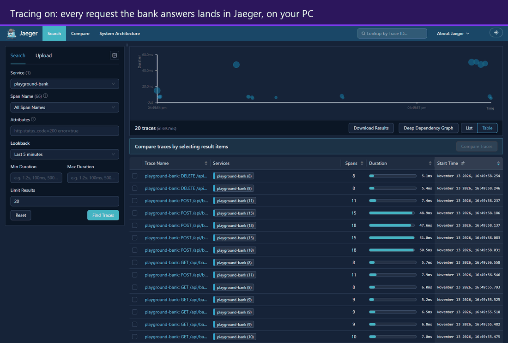
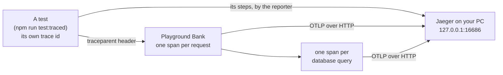
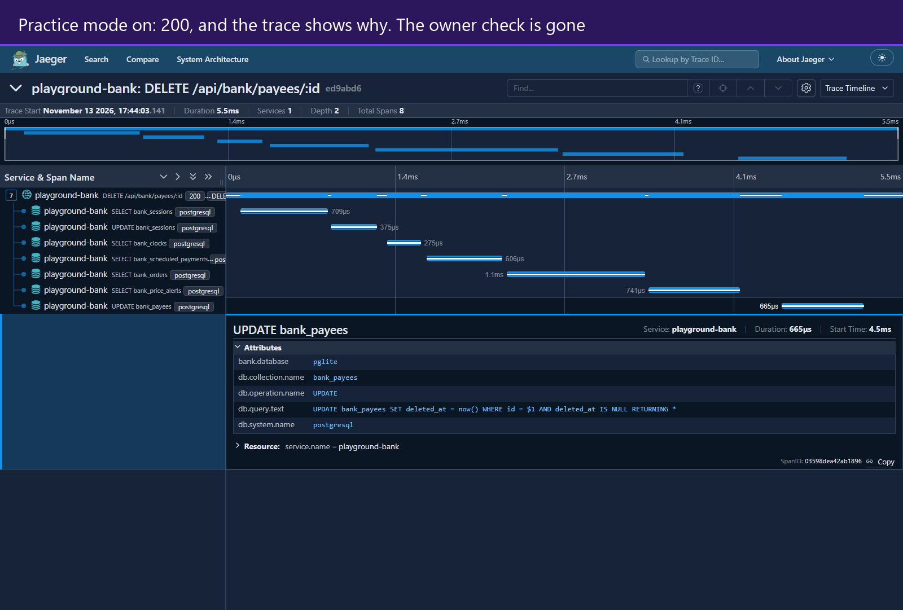

# Tracing

[← Back to the README](../../README.md)

Playground Bank can record what it does with each request, step by step, and
show it as one timeline: the request on top, and every database query it ran
underneath, each with its own time. It runs on your PC only, built from free,
open-source parts: OpenTelemetry to record, Jaeger to show. It is off unless
you switch it on.

<p align="center">
  
</p>
<p align="center">
  <sub>The trace list, one sign-in and its queries, then a planted bug: the same delete with practice mode off (404, the query checks the owner) and on (200, the check is gone). Last, the same bug from its own test: the test's steps (blue) and the bank's spans (orange) in one trace. Recorded by <code>npm run media:record -- tracing</code>.</sub>
</p>



<p align="center">
  
</p>
<p align="center">
  <sub>A planted bug, caught by its trace. With practice mode on, one customer deletes another customer's saved payee and gets 200. The trace shows why: the query is <code>WHERE id = $1</code>, with no <code>AND user_id = $2</code>, so it never checks who owns the payee.</sub>
</p>

## Words

- **Span:** one timed piece of work: a name, a start, an end, ok or error.
- **Trace:** the spans of one action, sharing one trace id, nested into a
  timeline.
- **`traceparent`:** the standard W3C header a caller sends to say "this
  request is part of my trace". The bank's span then joins that trace.
- **OTLP:** OpenTelemetry's format for sending spans. The bank sends it as
  JSON over HTTP.

## Try it

You need Docker Desktop running.

1. Start Jaeger:

   ```bash
   npm run trace:up
   ```

2. Start the site with tracing on (it builds the React app first; wait for
   "running at http://127.0.0.1:4173"):

   ```bash
   npm run trace:start
   ```

3. Use the site at `http://127.0.0.1:4173/app`, then open
   `http://127.0.0.1:16686`, pick **playground-bank** under Service, and press
   **Find Traces**.

4. To find one exact request, copy its `X-Request-Id` answer header from the
   browser's DevTools and search the Tags box for `bank.request_id=<that id>`.

5. Stop the site with `Ctrl+C`, then stop Jaeger (this wipes its traces):

   ```bash
   npm run trace:down
   ```

## From the tests

`npm run test:traced` runs Playwright tests with tracing on. It takes the same
arguments as `npx playwright test`, and needs Jaeger up and port 4173 free (it
starts its own site, with tracing on):

```bash
npm run test:traced -- tests/e2e/app/bank-money-bugs.spec.ts -g bankPayeeIdor
```

- **Each test gets its own trace.** The fixture every spec already uses
  (`framework/fixtures/resultBlock.ts`) gives it a trace id and adds a
  `traceparent` header to the page's requests and the `request` fixture's
  calls, so the bank's spans join the test's trace. No spec changes.
- **Its [RESULT] block links to it:** `trace : http://127.0.0.1:16686/trace/<id>`.
  The HTML report shows the same link as an annotation.
- **Its steps join the timeline.** A reporter
  (`framework/reporting/otelReporter.ts`) sends the test and its steps as
  spans under the service `playwright-tests`, so Jaeger shows the test's steps
  (blue) and the bank's request and queries (orange) together. The test's span
  covers all of its steps; Playwright's own fixture set-up steps are left out.
- **Step names are made safe.** Playwright names an `expect` with a custom
  message after that message, and a helper that passes a response body as the
  message would put the body in Jaeger. A name that looks like data (it starts
  with `{` or `[`) is hidden, API keys (`pbk_…`) and bearer tokens are masked,
  and names are cut at 120 characters.
- **Where a request sits:** the bank's request span hangs under the test's
  span, next to the step that sent it and in time order, not inside that step:
  a request can only name the span its test started with.

Run any other way (`npm test`, CI), the fixture adds nothing and the reporter
is not loaded.

## What a span keeps, and what it never keeps

- **Kept:** the route (`DELETE /api/bank/payees/:id`), the status code, the
  bank's request id (the same one the audit log keeps), each query's SQL text
  with its `$1` placeholders, the table, and which database answered.
- **Never kept:** the values sent with a query, cookies, headers, request
  bodies, or an error's message, because a message can quote a value. An error
  is labelled by its code instead (Postgres gives one, like `23505`).
- **Errors:** a 5xx answer marks the request's span as an error. A 4xx shows
  as its status code but is not an error: it is the caller's mistake, not the
  bank's (OpenTelemetry's rule for a server span).
- **Only requests:** queries the bank runs while starting up (migrations, demo
  data) get no span, so Jaeger shows request traces only.

## When it is on

Only when `OTEL_EXPORTER_OTLP_ENDPOINT` is set, which is OpenTelemetry's own
standard switch; `npm run trace:start` and `npm run test:traced` are what set
it. `npm start`, the normal test suite, CI and the live site on Render don't
set it, so there the OpenTelemetry packages are never even loaded.

Jaeger keeps traces in memory only, at most 10,000, and stopping it wipes
them. It listens on `127.0.0.1` only, so nothing outside your PC can reach it,
and it never runs in CI.

## Its test

```bash
npm run test:tracing
```

Twelve tests, no Docker: the spec starts its own server with tracing on and
points it at a pretend trace viewer inside the test. For the bank, they check
that the caller's trace is kept, that each query sits under its request and
within its time, that no value reaches a span, that a 4xx is not an error,
that a broken `traceparent` starts a fresh trace, the off switch, the route
names and the error labels. For the tests' side: each test's trace, header and
link, the header added only with a trace, the reporter's spans (nested,
covering every step, failures marked) and safe step names. The normal suite
and CI don't run it; the normal suite already proves that tracing switched off
changes nothing.

## Built from

All free and open source, with no AI and no paid service:

- OpenTelemetry for Node, its 3.x line (`@opentelemetry/sdk-trace` and its
  partners), in `bank/tracing.js`.
- Jaeger v2.23.0, pinned by digest in `docker-compose.yml` under its own
  `tracing` profile, with its settings in `scripts/tracing/jaeger.yaml`.

## Files

| File                                  | What it does                                          |
| ------------------------------------- | ----------------------------------------------------- |
| `bank/tracing.js`                     | The spans: on/off, requests, queries, what is kept    |
| `bank/index.js`                       | Starts tracing, wraps the database, runs each request |
| `scripts/tracing/start-traced.js`     | `npm run trace:start`: the site with tracing on       |
| `scripts/tracing/test-traced.js`      | `npm run test:traced`: tests with tracing on          |
| `scripts/tracing/jaeger.yaml`         | Jaeger's settings: memory only, 10,000 traces         |
| `docker-compose.yml`                  | The `jaeger` service, under the `tracing` profile     |
| `framework/helpers/testTrace.ts`      | A test's trace id, header and link                    |
| `framework/fixtures/resultBlock.ts`   | Adds the header and the RESULT block's `trace` line   |
| `framework/reporting/otelReporter.ts` | Sends each test and its steps as spans                |
| `playwright.config.ts`                | Loads that reporter only with tracing on              |
| `tests/tracing/bank-tracing.spec.ts`  | The twelve tests                                      |
| `framework/helpers/otlpReceiver.ts`   | The pretend trace viewer the tests send to            |
| `playwright.tracing.config.ts`        | Keeps the tests out of the normal suite and CI        |
