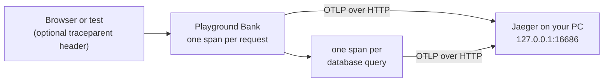

# Tracing

[← Back to the README](../../README.md)

Playground Bank can record what it does with each request, step by step, and
show it as one timeline: the request on top, and every database query it ran
underneath, each with its own time. It runs on your PC only, built from free,
open-source parts: OpenTelemetry to record, Jaeger to show. It is off unless
you switch it on.

<p align="center">
  
</p>
<p align="center">
  <sub>The trace list, one sign-in and its queries, then a planted bug: the same delete with practice mode off (404, the query checks the owner) and on (200, the check is gone). Recorded by <code>npm run media:record -- tracing</code>.</sub>
</p>



<p align="center">
  
</p>
<p align="center">
  <sub>A planted bug, caught by its trace. With practice mode on, one customer deletes another customer's saved payee and gets 200. The trace shows why: the query is <code>WHERE id = $1</code>, with no <code>AND user_id = $2</code>, so it never checks who owns the payee.</sub>
</p>

## Words

- **Span:** one timed piece of work: a name, a start, an end, ok or error.
- **Trace:** the spans of one action, sharing one trace id, nested into a
  timeline.
- **`traceparent`:** the standard W3C header a caller sends to say "this
  request is part of my trace". The bank's span then joins that trace.
- **OTLP:** OpenTelemetry's format for sending spans. The bank sends it as
  JSON over HTTP.

## Try it

You need Docker Desktop running.

1. Start Jaeger:

   ```bash
   npm run trace:up
   ```

2. Start the site with tracing on (it builds the React app first; wait for
   "running at http://127.0.0.1:4173"):

   ```bash
   npm run trace:start
   ```

3. Use the site at `http://127.0.0.1:4173/app`, then open
   `http://127.0.0.1:16686`, pick **playground-bank** under Service, and press
   **Find Traces**.

4. To find one exact request, copy its `X-Request-Id` answer header from the
   browser's DevTools and search the Tags box for `bank.request_id=<that id>`.

5. Stop the site with `Ctrl+C`, then stop Jaeger (this wipes its traces):

   ```bash
   npm run trace:down
   ```

## What a span keeps, and what it never keeps

- **Kept:** the route (`DELETE /api/bank/payees/:id`), the status code, the
  bank's request id (the same one the audit log keeps), each query's SQL text
  with its `$1` placeholders, the table, and which database answered.
- **Never kept:** the values sent with a query, cookies, headers, request
  bodies, or an error's message, because a message can quote a value. An error
  is labelled by its code instead (Postgres gives one, like `23505`).
- **Errors:** a 5xx answer marks the request's span as an error. A 4xx shows
  as its status code but is not an error: it is the caller's mistake, not the
  bank's (OpenTelemetry's rule for a server span).
- **Only requests:** queries the bank runs while starting up (migrations, demo
  data) get no span, so Jaeger shows request traces only.

## When it is on

Only when `OTEL_EXPORTER_OTLP_ENDPOINT` is set, which is OpenTelemetry's own
standard switch, and `npm run trace:start` is what sets it. `npm start`, the
test suite, CI and the live site on Render don't set it, so there the
OpenTelemetry packages are never even loaded.

Jaeger keeps traces in memory only, at most 10,000, and stopping it wipes
them. It listens on `127.0.0.1` only, so nothing outside your PC can reach it,
and it never runs in CI.

## Its test

```bash
npm run test:tracing
```

Eight tests, no Docker: the spec starts its own server with tracing on and
points it at a pretend trace viewer inside the test. They check that the
caller's trace is kept, that each query sits under its request and within its
time, that no value reaches a span, that a 4xx is not an error, that a broken
`traceparent` starts a fresh trace, the off switch, the route names and the
error labels. The normal suite and CI don't run it; the normal suite already
proves that tracing switched off changes nothing.

## Not yet

A trace starts at the bank. The tests don't send their own trace id yet, so a
test's own steps are not on the timeline.

## Built from

All free and open source, with no AI and no paid service:

- OpenTelemetry for Node, its 3.x line (`@opentelemetry/sdk-trace` and its
  partners), in `bank/tracing.js`.
- Jaeger v2.23.0, pinned by digest in `docker-compose.yml` under its own
  `tracing` profile, with its settings in `scripts/tracing/jaeger.yaml`.

## Files

| File                                 | What it does                                          |
| ------------------------------------ | ----------------------------------------------------- |
| `bank/tracing.js`                    | The spans: on/off, requests, queries, what is kept    |
| `bank/index.js`                      | Starts tracing, wraps the database, runs each request |
| `scripts/tracing/start-traced.js`    | `npm run trace:start`: the site with tracing on       |
| `scripts/tracing/jaeger.yaml`        | Jaeger's settings: memory only, 10,000 traces         |
| `docker-compose.yml`                 | The `jaeger` service, under the `tracing` profile     |
| `tests/tracing/bank-tracing.spec.ts` | The eight tests                                       |
| `framework/helpers/otlpReceiver.ts`  | The pretend trace viewer the tests send to            |
| `playwright.tracing.config.ts`       | Keeps the tests out of the normal suite and CI        |
